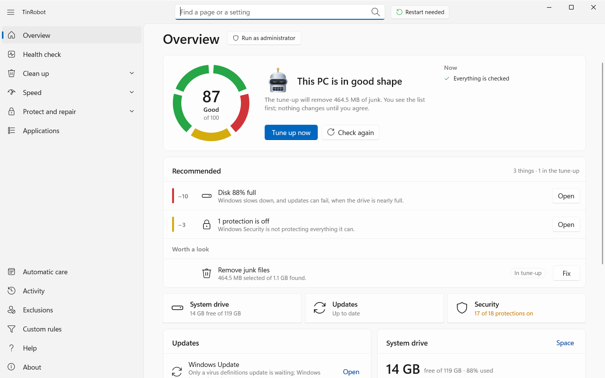

  

<h3 align="center">TinRobot keeps Windows clean, light and quick, and you can undo anything.</h3>

  Free and open source · Windows 10 and 11, x64 and Arm64 · No telemetry, no accounts, no ads

  

TinRobot checks how Windows is doing, clears out junk, trims what starts with Windows, switches off what you do
not want and tunes the rest. It shows what it will do before doing it, keeps a way back for every change, and
writes each change down. It calls Windows directly and never runs PowerShell or scripts.

- **[tinrobot](https://github.com/tinrobotpc/tinrobot)**: the app and its command line, `tinrobot-cli`
- **[Guide](https://github.com/tinrobotpc/tinrobot/blob/main/docs/guide.md)**: what each tool does, never does, and how to undo it
- **[Privacy](https://github.com/tinrobotpc/tinrobot/blob/main/docs/privacy.md)** and **[Security](https://github.com/tinrobotpc/tinrobot/blob/main/SECURITY.md)**
- **[Contributing](https://github.com/tinrobotpc/tinrobot/blob/main/CONTRIBUTING.md)**

MIT licence.
